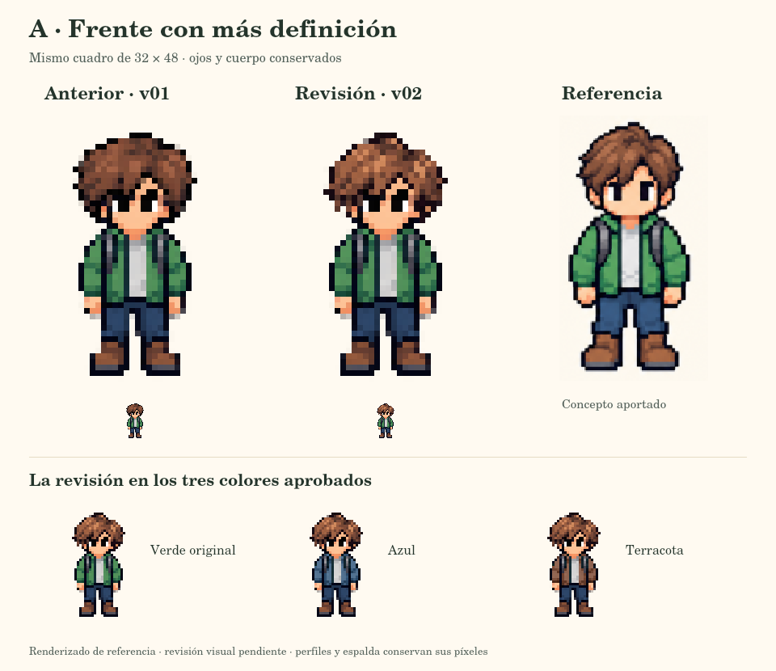

# A v02 — Frente con más definición

- Proyecto: programation-world. Historia: S0-03, arte y personalización.
- Fecha: 2026-10-20. Versión: 0.1.
- Estado: revisión frontal implementada y verificada; aceptación visual pendiente del Product Owner.
- Solicitud: «la verdad me gustaria un poco mas de detalle y que sea mas parecido, el A de frende que este mucho mas chevere y definido».

## Resultado

Se refinó el cabello frontal de A siguiendo la referencia aportada: raya más clara, mechones diagonales separados, contorno con puntas intencionales y mayor contraste entre luces y sombras. El detalle se organiza para que se lea dentro del cuadro nativo; la resolución continúa siendo 32 × 48 y el anclaje (16, 46).



La comparación muestra A v01, A v02 y el concepto aportado. Los dos primeros usan la misma cabeza, cuerpo y escala nativa. El concepto es una referencia ilustrada; no se presenta como un sprite nativo idéntico.

La producción previa queda conservada. El compositor sigue reutilizando los ojos aprobados: una columna blanca exterior y dos negras hacia el centro en cada ojo frontal. Los perfiles, la espalda y la cabeza auxiliar conservan sus píxeles. El cuerpo desde la fila 22, la ropa, las botas, el anclaje y las poses se mantienen.

## Abrir la revisión

Abrir [avatar-head-lab.html](../../tools/art-preview/avatar-head-lab.html) desde la copia local de esta revisión. Comparar las cuatro direcciones, los tres colores, reposo, marcha, paso manual y capas. El original aprobado permanece como control junto a A v02.

La [hoja frontal de reposo y marcha](../qa/avatar-front-v02-walk.png) muestra los tres colores y las cinco poses frontales. Las poses de marcha siguen la secuencia existente; no se cambió su orden.

## Fuentes y exportación

| Archivo | Responsabilidad |
| --- | --- |
| [Referencia recibida](../../art/references/reviews/hair-a-front-reference-v02.png) | Copia sin modificar de image(8).png. |
| [Fuente frontal v02](../../art/concepts/avatars/avatar-hair-a-front-source-v02.png) | Cabello frontal sobre transparencia, generado con image_gen integrado. |
| [Prompt y procedencia](../../art/concepts/avatars/avatar-hair-a-front-source-v02.json) | Prompt exacto, roles de las tres referencias, dimensiones, hashes y solicitud. |
| [Manifiesto v02](../../art/exports/avatars/avatar-head-layers-a-v02.json) | Recorte, destino, hashes y contrato de la revisión. |
| [Tira nativa v02](../../art/exports/avatars/avatar-hair-sidepart-v02.png) | Frente nuevo y tres columnas anteriores idénticas. |
| [Exportador frontal](../../tools/art-preview/export-avatar-front-v02.cjs) | Compila solo el frente y comprueba los píxeles protegidos. |
| [Renderizador de QA](../../tools/art-preview/render-avatar-front-v02.cjs) | Reproduce las comparaciones y los 30 controles de Canvas. |

La fuente de 1254 × 1254 se conserva sin retoques. Se toma el recorte (247, 368, 775, 557) y se muestrea sin suavizado a 22 × 16 dentro del cuadro, en (5, 3). El resto de la tira se copia de v01 con igualdad RGBA. Esta compilación del recurso del juego no modifica el PNG generado.

La exportación opcional requiere pngjs 7.0.0; el renderizado de evidencias usa además @napi-rs/canvas 0.1.100. Son herramientas de autoría, sin nuevas dependencias del cliente. El visor y los controles de CI no necesitan esos paquetes.

```sh
node tools/art-preview/export-avatar-front-v02.cjs
python tools/art-preview/build-avatar-head-data.py
node tools/art-preview/render-avatar-front-v02.cjs
```

El manifiesto v01 y su tira de cabello se conservan. El generador de datos incluye la ruta del manifiesto activo para que los controles comprueben la revisión correcta. El archivo de apariencia sigue en schemaVersion 1: aún guarda solamente avatar y color de abrigo.

## Verificación

- [Controles de composición](../qa/avatar-front-v02-checks.json): 120 composiciones, ojos exactos, cuerpo conservado, ausencia de mutación y cabeza estable durante la marcha.
- [Controles del controlador](../qa/avatar-front-v02-controller-checks.json): inicio, direcciones, colores, animación, paso manual, capas y reposo con un adaptador DOM/Canvas.
- [Controles de renderizado](../qa/avatar-front-v02-render-checks.json): 30 cuadros frontales de v01/v02, tres colores y cinco poses; ojos y cuerpo iguales al pasar ambos lados por el mismo Canvas.
- Coincidencia de datos locales y PNG, integridad de fuentes y exportaciones, y columnas de perfiles/espalda comprobadas.

Canvas puede redondear RGB de píxeles semitransparentes al convertir alfa premultiplicado. Por eso la comprobación renderizada compara ambas imágenes mediante el mismo recorrido de Canvas. La comprobación RGBA del compositor verifica por separado la igualdad exacta de los bytes protegidos.

Los registros anteriores siguen siendo históricos. Estos controles no ejecutan un navegador real ni prueban disposición visual o foco del teclado.

## Revisión y siguiente paso

- [ ] Revisar si el nuevo frente se aproxima al detalle y forma de la referencia.
- [ ] Registrar aceptación visual o ajustes concretos del Product Owner.
- [ ] Comprobar controles y presentación en un navegador real.

Los conceptos original, A y B conservan su aceptación previa. Esta revisión no registra la aprobación nativa de A ni produce las capas de B. Después de revisar el frente se continuará con B y con el selector y su guardado. S0-03 permanece abierta.

La referencia procede de la conversación y de la lámina del propio proyecto. No se añaden marcas, instituciones ni identidades reales. Los pendientes generales de procedencia y licencia conservan su estado.
