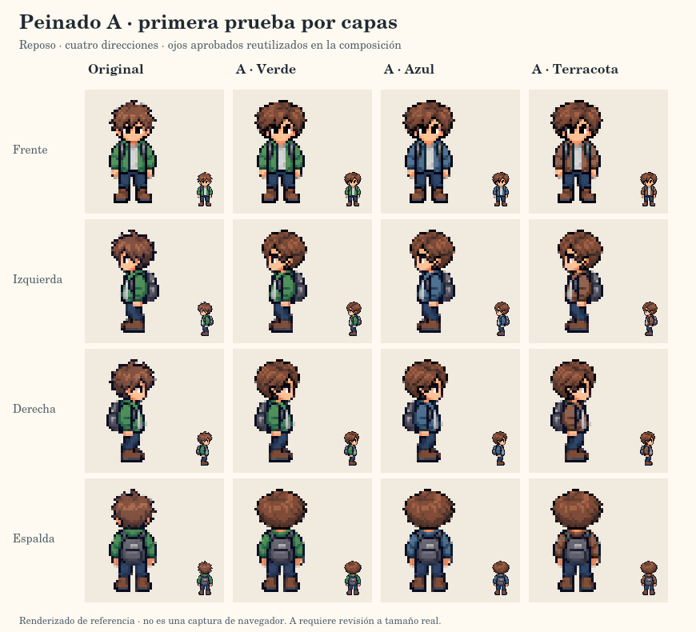

# Revisión de la importación a GitHub

- Fecha: 2026-10-20.
- Tarea: integrar y verificar la base de preproducción, sin cerrar Sprint 0.
- Fuentes: carga del usuario en el commit [08071eb](https://github.com/nagiseishiro123456-creator/programation-world/commit/08071ebd869dddef62856ec791210ca5d688799f).
- Resultado estructurado: [github-import-checks-v01.json](github-import-checks-v01.json).

## Hallazgos y correcciones

| Hallazgo | Corrección |
| --- | --- |
| Proyecto dentro de una carpeta de entrega adicional. | Carpetas integradas en la raíz del repositorio. |
| README de la raíz con solo la descripción inicial. | Estado, visores, comandos y documentación actualizados. |
| Documentos que aún reservaban commit y push al usuario y GitHub para después. | Flujo actualizado según la autorización del 2026-10-20. |
| Ausencia de .gitignore, .gitattributes y plantillas citadas en los documentos. | Reglas y plantillas nuevas añadidas. No se afirma recuperar su contenido original del ZIP. |
| No había verificación automática de la importación. | Verificador de archivos, enlaces y JSON, más automatización de los controles existentes. |
| Generadores Python usaban la codificación por defecto. | Lectura y escritura UTF-8 explícitas, para comprobar también en Windows. |

## Integridad

La carga contenía 93 archivos del proyecto y 36 de ellos eran binarios. La reorganización reutiliza los mismos objetos Git de esos binarios y conserva el historial. No se regeneran imágenes, atlas ni el video.

El ZIP preparado antes de la importación tenía 97 archivos según el registro anterior. No se ha vuelto a leer el ZIP en esta ejecución. Se revisan las fuentes publicadas y se reponen las reglas y plantillas necesarias con contenido nuevo.

El verificador comprueba los destinos locales de enlaces Markdown y recursos HTML, incluyendo directorios. Las rutas de módulos del futuro juego se documentan como previstas, sin exigir carpetas todavía vacías.

## Comprobaciones ejecutadas en esta revisión

Las fuentes se obtuvieron desde GitHub y se comprobaron en el V8 de functions.exec:

- Sintaxis de los 14 archivos JavaScript de la carga.
- Coincidencia de snapshots y manifiestos de reposo, marcha, colores y capas.
- 120 composiciones de original y A: ojos exactos, cuerpo conservado desde fila 22 e identidad de cabeza durante marcha.
- Transparencia, regiones protegidas y guardado/carga JSON de los tres colores.
- Tiempo del ciclo y direcciones del movimiento.
- Inicio del controlador, dirección, color, reproducción, paso manual, vuelta del ciclo, capas y reposo con un adaptador DOM/Canvas mínimo.

El nuevo verificador de integridad también se ejecuta en V8 con el inventario preparado. Esto no equivale a ejecutar Node, Python ni un navegador local.

## Automatización

[GitHub Actions](https://github.com/nagiseishiro123456-creator/programation-world/actions) ejecuta los cuatro verificadores Node existentes, el nuevo verificador de integridad y las dos comprobaciones Python de snapshots.

La matriz usa Linux y Windows, Node.js 24 y Python 3.13. Las acciones oficiales se fijan a SHA; no se instalan paquetes del proyecto. La configuración se basa en las versiones verificadas de [checkout](https://github.com/actions/checkout/releases/tag/v7.0.1), [setup-node](https://github.com/actions/setup-node/releases/tag/v7.1.0) y [setup-python](https://github.com/actions/setup-python/releases/tag/v7.0.0).

La ejecución remota y sus resultados se vinculan al commit comprobado. La presencia del workflow por sí sola no demuestra que sus controles hayan pasado.

## Resultado remoto confirmado

La [ejecución 39492489517](https://github.com/nagiseishiro123456-creator/programation-world/actions/runs/39492489517) terminó con éxito sobre [1cb3d39](https://github.com/nagiseishiro123456-creator/programation-world/commit/1cb3d39c60a7f07921dfa8cbcd59b7b487003388). Pasaron las siete comprobaciones en ambos sistemas: integridad, marcha, colores, capas, controlador y los dos snapshots Python. Se verificaron también los hashes de las fuentes y exportaciones activas que comprueban los scripts.

El árbol incorporado contiene 102 archivos. Sus 66 archivos de texto se comprobaron por hash Git frente al contenido preparado; los 36 binarios conservan los objetos de la carga original. El verificador de integridad comprobó 21 JSON y 125 referencias locales sin errores.

Este resultado corresponde a los controles automatizados de preproducción. La revisión de navegador, disposición visual y aceptación de A sigue pendiente.

## Revisión visual pendiente

La imagen es un renderizado de referencia. Abrir [avatar-head-lab.html](../../tools/art-preview/avatar-head-lab.html) desde una copia local y registrar:

- Navegador, versión y resolución.
- Frente, perfiles y espalda, con los tres colores.
- Marcha, reposo, paso manual y restauración de capas.
- Ajuste de orejas, rostro, cabello, cuello y mochila a 32 × 48 y ampliado.
- Ojos frontales con negro hacia el centro y blanco exterior.
- Aceptación del resultado nativo o ajustes concretos.

La aprobación del concepto A sigue vigente; se revisa su producción. B conserva el concepto aprobado y aún no tiene capas nativas. El mundo educativo y las funciones sociales siguen pendientes.
